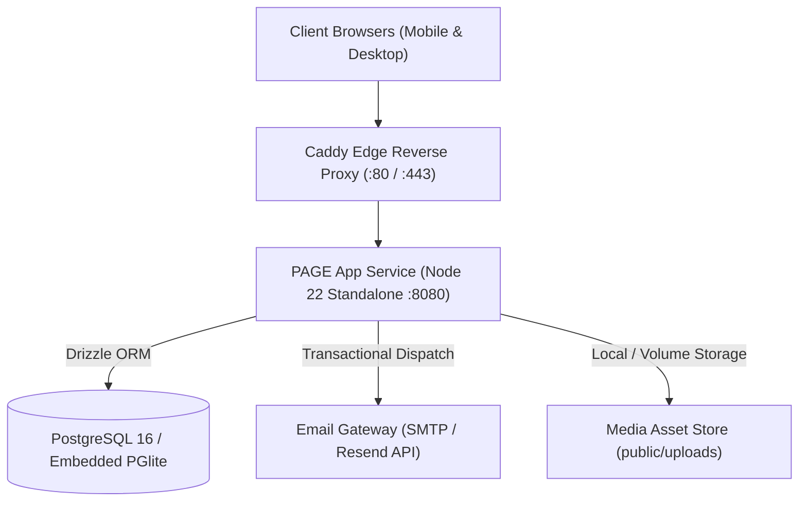

# PAGE International Ltd. — Commercial B2B Digital Platform

A production-hardened, high-performance B2B procurement and technical consultation platform built for **PAGE International Ltd.**, a premier distributor of automotive workshop machinery, diagnostic stations, and spare parts in Bangladesh.

---

## 🏛️ System Architecture



### Technology Stack

- **Framework & SSR:** TanStack Start & React 19 on Vite 8
- **Server Runtime:** Nitro 3 Engine (Standalone Node Server preset)
- **Database & ORM:** PostgreSQL 16 (production) / Embedded `@electric-sql/pglite` (zero-dependency local development) with Drizzle ORM
- **Authentication & Security:** HTTP-only strict cookies (`page_session`), bcrypt (cost 12), SHA-256 token hashing, sliding-window IP rate limiting, magic-bytes MIME validation
- **Reverse Proxy & Edge:** Caddy (Alpine) with automatic HTTPS, zstd/gzip compression, and strict security headers
- **Styling & UI:** Tailwind CSS v4, Lucide Icons, Radix UI primitives, Recharts

---

## 🚀 Quickstart (Local Windows Development)

The platform is designed to run locally on Windows, macOS, or Linux with **zero external database dependencies** required out of the box using embedded PGlite.

### Prerequisites

- Node.js 20.x or 22.x LTS
- npm 10+

### Step-by-Step Setup

1. **Clone and Install:**

   ```powershell
   git clone <repository-url>
   cd pixel-perfect
   npm install
   ```

2. **Configure Environment:**

   ```powershell
   cp .env.example .env
   ```

3. **Run Migrations & Seed Initial Data:**

   ```powershell
   npm run db:migrate
   npm run db:seed
   ```

   _Seeds the full product catalog, initial technical articles, banners, and the default administrator account (`admin@page-bd.com` / `PageAdmin2026!Secure`)._

4. **Start Development Server:**
   ```powershell
   npm run dev
   ```
   Open [http://localhost:8080](http://localhost:8080) in your browser.

---

## 🐳 Docker Production Setup (VPS / Cloud)

Run the entire hardened production stack (App + PostgreSQL 16 + Caddy) with a single command:

```bash
# 1. Prepare production environment
cp .env.example .env
# Edit .env with your domain (DOMAIN=page-bd.com) and secure database credentials

# 2. Build and launch containers
docker compose up -d --build

# 3. Apply database migrations and seed inside the container
docker compose exec app npm run db:migrate
docker compose exec app npm run db:seed

# 4. Check status and health
curl -f http://localhost/api/health
```

---

## 📜 Available NPM Scripts

| Command              | Description                                                                      |
| -------------------- | -------------------------------------------------------------------------------- |
| `npm run dev`        | Starts Vite development server with hot module replacement on port 8080          |
| `npm run build`      | Builds client assets and standalone Node SSR server (`.output/server/index.mjs`) |
| `npm run preview`    | Starts the production built server on port 8080 for verification                 |
| `npm run lint`       | Runs ESLint across all TypeScript and React sources                              |
| `npm run format`     | Enforces code formatting via Prettier across all files                           |
| `npm test`           | Executes unit and integration test suite via Vitest                              |
| `npm run test:e2e`   | Runs Playwright end-to-end browser tests across critical user journeys           |
| `npm run db:migrate` | Runs all pending Drizzle SQL migrations against active database                  |
| `npm run db:seed`    | Idempotently seeds initial catalog, updates, and admin user                      |
| `npm run db:status`  | Prints connection health, engine type, and row counts across all 16 tables       |
| `npm run db:backup`  | Exports all database records into a portable timestamped JSON backup             |
| `npm run db:restore` | Restores database records from a specified backup file                           |

---

## 🔒 Security Architecture Highlights

- **Zero Client-Side Business State:** All RFQ quotes, bookings, orders, inventory changes, banners, updates, and customer data are validated server-side with Zod and persisted directly to PostgreSQL. Legacy `localStorage` has been eliminated.
- **Zero-Trust Pricing:** Order totals and line subtotals are always computed from database product records on the server; client-submitted prices are discarded.
- **Robust Authentication:** Admin and customer sessions use HTTP-only, SameSite=Lax cookies with 256-bit cryptographically random tokens and bcrypt (cost 12) password hashing.
- **Rate Limiting:** Sliding-window IP rate limiter protects authentication, password reset, and RFQ submission endpoints.
- **Media Upload Sanitization:** File uploads verify genuine magic bytes (JPEG, PNG, WEBP, PDF) and enforce path containment to prevent directory traversal.

---

## 📄 License

Proprietary and Confidential. Copyright © 2026 PAGE International Ltd. All rights reserved.
