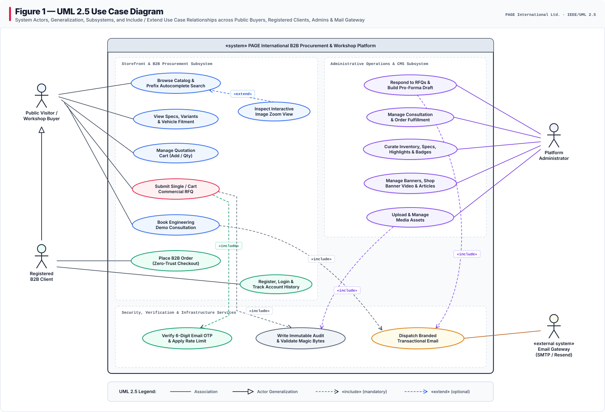
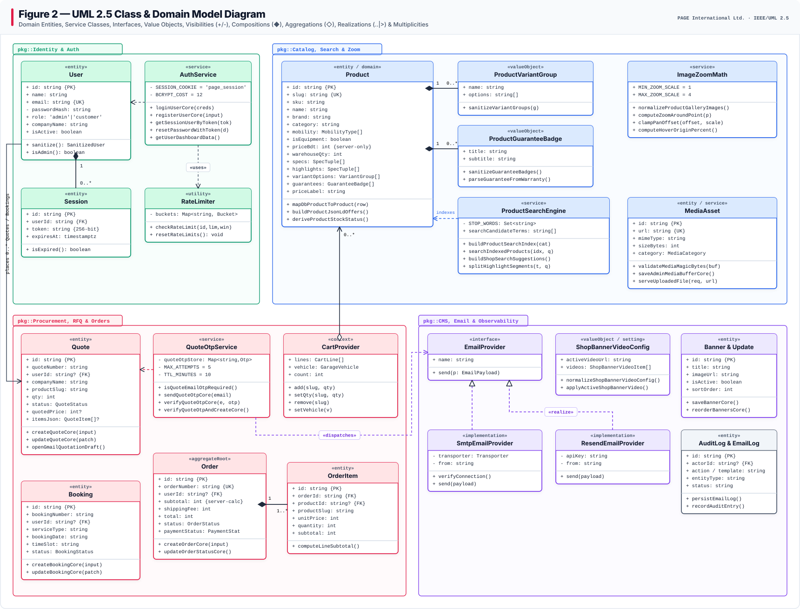
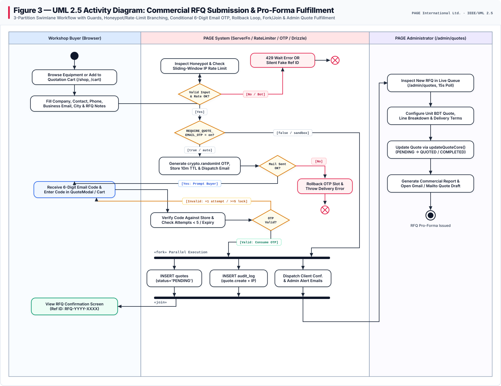
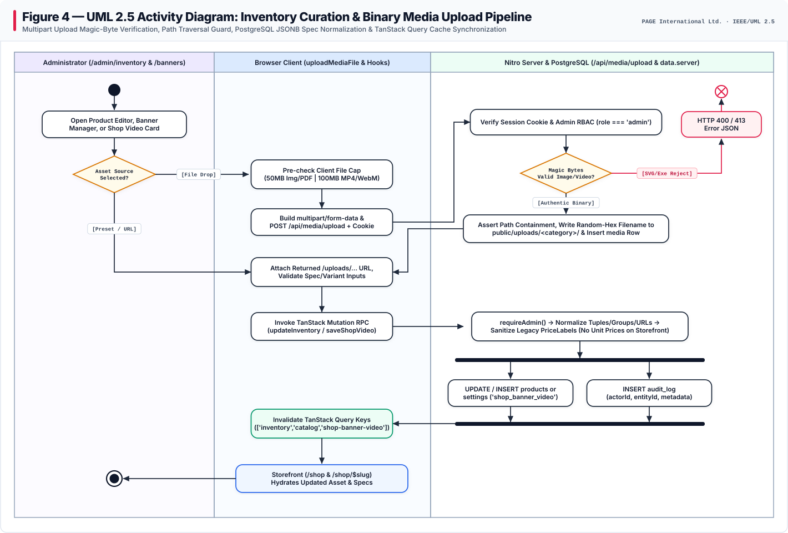
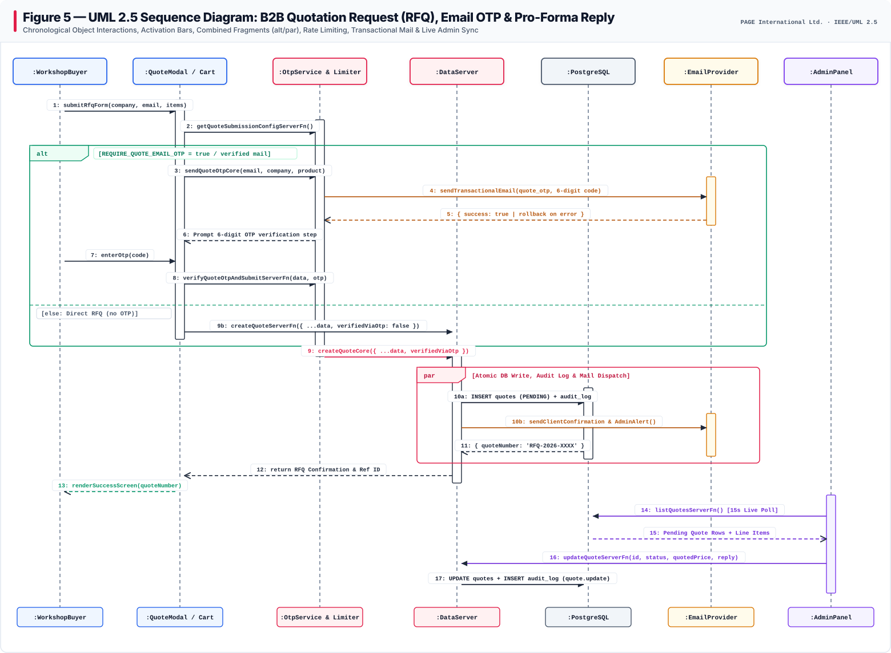
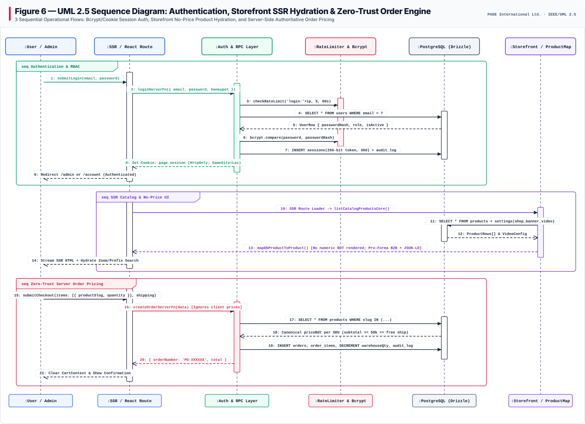
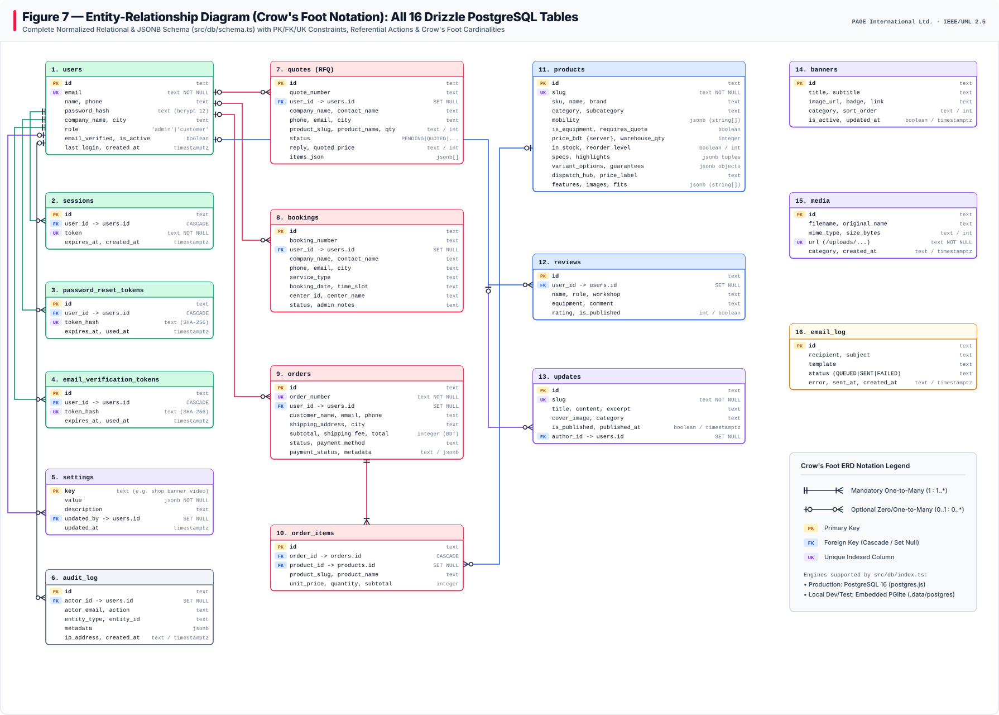
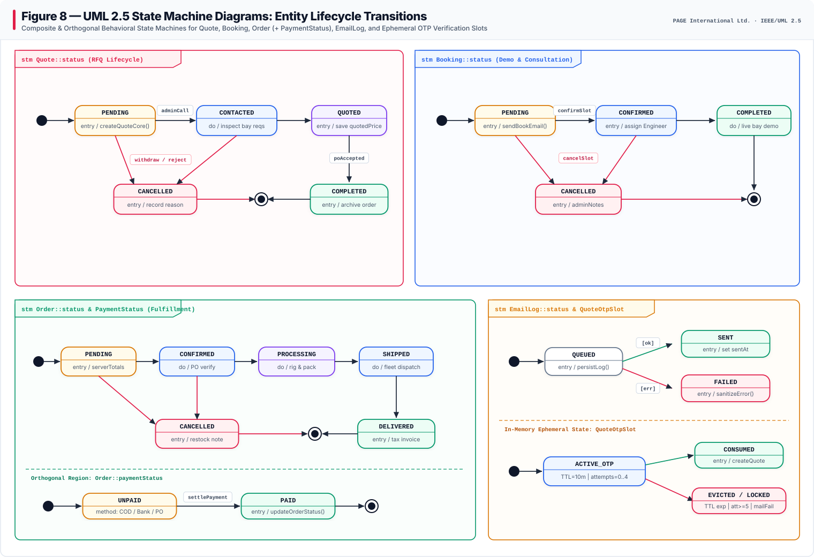
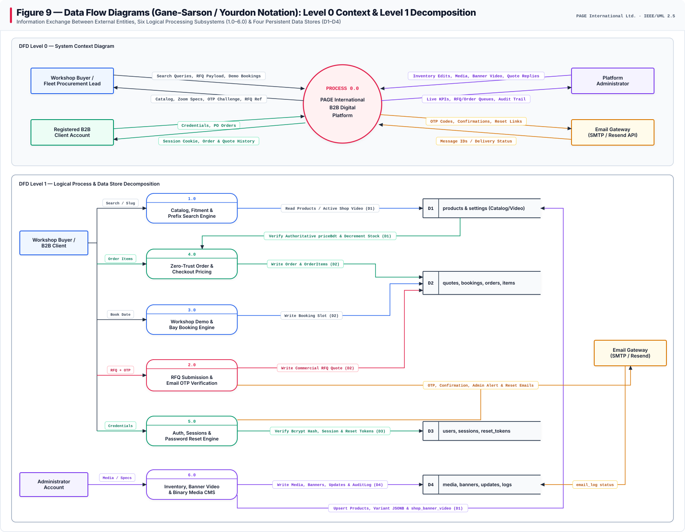
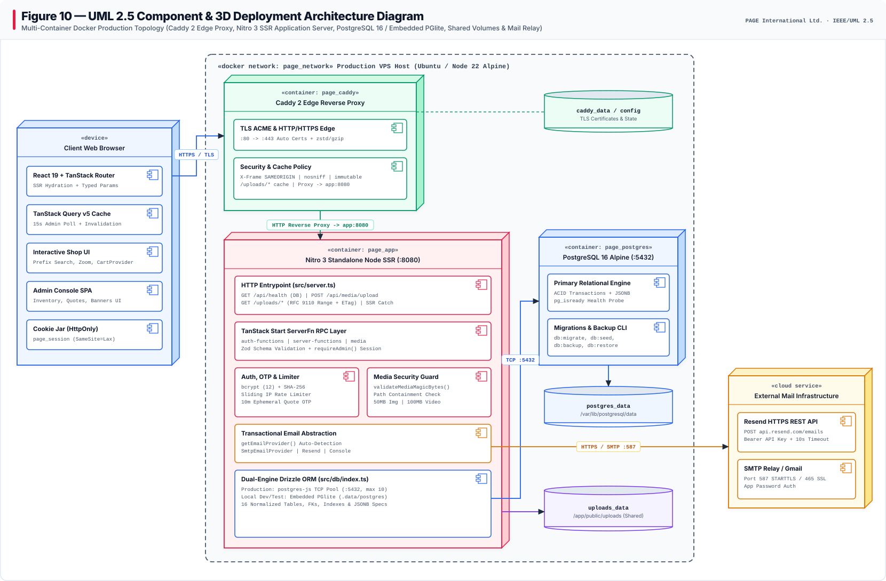

# Software Engineering Project Report — PAGE International B2B Workshop Equipment & Procurement Platform

> **Repository:** `pixel-perfect` (`tanstack_start_ts`)  
> **Organization:** PAGE International Ltd. — _"The Company Behind The Workshop"_  
> **Address:** Road #18, House #100, Sector #14, Uttara Model Town, Dhaka, Bangladesh  
> **Report Version:** 2.0.0  
> **Last Verified Against Codebase:** November 11, 2026 (`15/15` Vitest suites / `82/82` unit-integration tests passing)

---

## Table of Contents

1. [Document Control & Executive Summary](#1-document-control--executive-summary)
2. [Business Domain, Problem Statement & No-Price Storefront Policy](#2-business-domain-problem-statement--no-price-storefront-policy)
3. [Stakeholders, User Personas & System Boundaries](#3-stakeholders-user-personas--system-boundaries)
4. [Functional & Non-Functional Requirements Traceability](#4-functional--non-functional-requirements-traceability)
5. [System Architecture & Technology Stack](#5-system-architecture--technology-stack)
6. [Comprehensive System Design & UML Diagrams](#6-comprehensive-system-design--uml-diagrams)
   - [6.1 UML 2.5 Use Case Diagram](#61-uml-25-use-case-diagram)
   - [6.2 UML 2.5 Class & Domain Model Diagram](#62-uml-25-class--domain-model-diagram)
   - [6.3 UML 2.5 Activity Diagram — RFQ Submission & Conditional Email OTP](#63-uml-25-activity-diagram--rfq-submission--conditional-email-otp)
   - [6.4 UML 2.5 Activity Diagram — Inventory Curation & Binary Media Upload](#64-uml-25-activity-diagram--inventory-curation--binary-media-upload)
   - [6.5 UML 2.5 Sequence Diagram — Commercial RFQ, OTP & Pro-Forma Reply](#65-uml-25-sequence-diagram--commercial-rfq-otp--pro-forma-reply)
   - [6.6 UML 2.5 Sequence Diagram — Auth, SSR Catalog Hydration & Zero-Trust Order Engine](#66-uml-25-sequence-diagram--auth-ssr-catalog-hydration--zero-trust-order-engine)
   - [6.7 Entity-Relationship Diagram (Crow's Foot — All 16 Tables)](#67-entity-relationship-diagram-crows-foot--all-16-tables)
   - [6.8 UML 2.5 State Machine Diagrams — Lifecycle Transitions](#68-uml-25-state-machine-diagrams--lifecycle-transitions)
   - [6.9 Data Flow Diagrams — Level 0 Context & Level 1 Decomposition](#69-data-flow-diagrams--level-0-context--level-1-decomposition)
   - [6.10 UML 2.5 Component & 3D Deployment Architecture](#610-uml-25-component--3d-deployment-architecture)
7. [Database Architecture & Complete 16-Table Data Dictionary](#7-database-architecture--complete-16-table-data-dictionary)
8. [Application Routing & Key Subsystems](#8-application-routing--key-subsystems)
9. [Security Architecture & Defense-in-Depth Controls](#9-security-architecture--defense-in-depth-controls)
10. [Quality Assurance, Testing & Verification Matrix](#10-quality-assurance-testing--verification-matrix)
11. [Deployment, Backup, Health & Operations Runbook](#11-deployment-backup-health--operations-runbook)
12. [Known Boundaries & Future Engineering Roadmap](#12-known-boundaries--future-engineering-roadmap)

---

## 1. Document Control & Executive Summary

| Metadata Field               | Verified System Value                                                                                                                        |
| :--------------------------- | :------------------------------------------------------------------------------------------------------------------------------------------- |
| **System Name**              | PAGE International B2B Workshop Equipment & Procurement Platform                                                                             |
| **Application Architecture** | Full-Stack Server-Side Rendered (SSR) React 19 + TanStack Start + Nitro 3 (`node-server`)                                                    |
| **Database Dual-Engine**     | PostgreSQL 16 (`postgres-js`, pool `max: 10`) in production; Embedded `@electric-sql/pglite` (`.data/postgres`) when `DATABASE_URL` is unset |
| **ORM & Migration Layer**    | Drizzle ORM `0.45.4` + Drizzle Kit `0.31.11` (`16` normalized PostgreSQL tables)                                                             |
| **Edge Reverse Proxy**       | Caddy 2 (`caddy:2-alpine`) with automated ACME TLS, `zstd`/`gzip`, security headers & `/uploads/*` caching                                   |
| **Diagram Standards**        | UML 2.5 (Use Case, Class, Activity, Sequence, State Machine, Component/Deployment), Crow's Foot ERD, Yourdon/Gane-Sarson DFD (Levels 0 & 1)  |
| **Automated Test Coverage**  | `15` Vitest suites (`82/82` passing assertions), Playwright Chromium E2E specs, ESLint, Prettier                                             |

**Executive Summary:**  
The PAGE International B2B Platform digitizes industrial workshop procurement across Bangladesh—covering heavy automotive lifts (2-post, 4-post, scissor), wheel aligners, diagnostic scanners, EV high-voltage insulated tooling, compressed-air bay systems, consumables, and live demonstration bay bookings in Uttara, Dhaka.

Unlike consumer e-commerce storefronts that publish static retail prices, PAGE operates an engineering-consultative **Request for Quotation (RFQ) & Pro-Forma B2B Procurement Model**. Public pages (`/`, `/shop`, `/shop/$slug`, `/cart`, and structured Schema.org JSON-LD telemetry) deliberately suppress all numeric currency amounts and display technical specifications, ordered key highlights, configurable engineering variants (e.g., `380V 3-Phase` vs `220V Single-Phase`), vehicle/fleet fitment compatibility, and interactive multi-scale zoom inspection (`1.0x–4.0x`). Commercial unit pricing (`priceBdt`) remains strictly server-side (`src/db/schema.ts`, `src/lib/data.server.ts`) until either an administrator issues an itemized commercial Pro-Forma draft via `/admin/quotes` (`src/lib/quotation-email.ts`), or an authenticated zero-trust checkout order recalculates authoritative pricing directly inside the backend transaction (`createOrderCore`).

---

## 2. Business Domain, Problem Statement & No-Price Storefront Policy

### 2.1 Industrial Workshop Procurement Context

Automotive service centers, commercial fleet depots, and EV battery bays procure capital machinery whose landed pricing varies substantially by:

- Electrical configuration (`220V Single-Phase` vs `380V 3-Phase`), civil anchoring depth, and floor-slab reinforcement requirements;
- Multi-bay bundle sizing, installation commissioning packages, operator calibration training, and warranty tier (`18–36 months`);
- Customs duty classifications, B2B corporate PO credit terms (`QUOTATION_PO`, `BANK_TRANSFER`, `CHEQUE`, `CASH_ON_DELIVERY`), and regional hub dispatch from Dhaka Central Hub.

### 2.2 Problem Statement Solved by This System

Prior offline catalog PDFs and manual phone/WhatsApp inquiries created four operational bottlenecks:

1. **Unstructured Spec Inquiries:** Workshop buyers lacked self-service fitment filtering by mobility class (`Car`, `Commercial`, `EV`, `Bike`, `Universal`), interactive high-resolution machinery inspection, and fast SKU autocomplete across technical specifications.
2. **Public Price Leakage Risk:** Publishing unadjusted BDT figures on public machinery cards caused tender confusion and conflicted with VAT/Mushak pro-forma pricing workflows.
3. **Unverified Spam & Fragile Upload Media Pipelines:** Public RFQ endpoints needed spam/bot mitigation (honeypot absorption + rate limits + conditional Email OTP), while admin media uploads required binary inspection rather than trusting spoofable MIME headers or writing slow Base64 strings through RPC payloads.
4. **Disconnected Fulfillment State:** Quote requests, live workshop bay demo bookings, product inventory stock levels, and audit logs needed one unified PostgreSQL source of truth with real-time administrative synchronization (`15s` polling + optimistic cache invalidation).

### 2.3 Storefront No-Price Architectural Invariant

As enforced across [`src/lib/product-utils.ts`](../src/lib/product-utils.ts) and [`src/routes/shop.index.tsx`](../src/routes/shop.index.tsx):

- **UI Presentation:** Public catalog cards (`ProductCard.tsx`), hero showcase (`EquipmentFanStack.tsx`), and equipment detail pages (`/shop/$slug`) display commercial availability (`In stock` / `Low stock` / `Out of stock`), dispatch hub (`Dhaka Central Hub`), highlights, variants, and `"Request Official Quote"` CTAs rather than monetary figures.
- **Label Sanitization:** `normalizeStorefrontPriceLabel()` intercepts legacy placeholder values such as `"B2B Unit Price"` and normalizes them to `"Pro-Forma B2B"`.
- **SEO Schema.org Hardening:** `buildProductJsonLdOffers()` emits valid `Offer` JSON-LD metadata (`url`, `availability`, `seller`) while omitting `price` and `priceCurrency` fields so search engines never index stale prices.

---

## 3. Stakeholders, User Personas & System Boundaries

| Persona / Actor                     | Access Scope                             | Primary Responsibilities & System Interactions                                                                                                                                                                                                                                                                                                                                                                                                         |
| :---------------------------------- | :--------------------------------------- | :----------------------------------------------------------------------------------------------------------------------------------------------------------------------------------------------------------------------------------------------------------------------------------------------------------------------------------------------------------------------------------------------------------------------------------------------------- |
| **Public Visitor / Workshop Buyer** | Unauthenticated (`role: guest`)          | Browses catalog & articles, queries prefix-first autocomplete search, filters by mobility & category, inspects interactive product zoom, views specs/variants/guarantees, manages local Quotation Cart (`CartProvider`), submits single-product or multi-item RFQs (with optional Email OTP), and books live bay demonstrations.                                                                                                                       |
| **Registered B2B Client**           | Authenticated (`role: customer`)         | Inherits all Workshop Buyer capabilities (UML Actor Generalization); logs in via `page_session` HTTP-only cookie, manages saved garage vehicle context, places zero-trust B2B checkout orders (`/checkout`), and tracks personal quotes, demo bookings, and order statuses in `/account`.                                                                                                                                                              |
| **Platform Administrator**          | Authenticated (`role: admin` or `staff`) | Manages all operational workspaces under `/admin/*`: live dashboard telemetry (`15s` poll), CRUD inventory with ordered specs/highlights/variants/guarantees, commercial RFQ pricing & Pro-Forma draft generation, consultation slot confirmations, homepage banners, **single-active Shop Banner Video configuration**, `/api/media/upload` binary asset curation, technical updates CMS, customer account activation toggles, and platform settings. |
| **Email Gateway (External System)** | Outbound Infrastructure                  | Dual-provider SMTP (`Nodemailer` supporting Gmail App Passwords on port `587`/`465`) or Resend HTTPS REST API (`api.resend.com/emails`) selected automatically by `getEmailProvider()`, logging terminal delivery states (`QUEUED` -> `SENT` / `FAILED`) to `email_log`.                                                                                                                                                                               |

---

## 4. Functional & Non-Functional Requirements Traceability

### 4.1 Functional Requirements

| Req ID    | Requirement Summary                                                                                                                                                                 | Verification & Primary Implementation Module                                                                                                                                                                        |
| :-------- | :---------------------------------------------------------------------------------------------------------------------------------------------------------------------------------- | :------------------------------------------------------------------------------------------------------------------------------------------------------------------------------------------------------------------ |
| **FR-01** | Dual-mode Catalog Browsing & No-Price Storefront                                                                                                                                    | [`src/routes/shop.index.tsx`](../src/routes/shop.index.tsx), [`src/routes/shop.$slug.tsx`](../src/routes/shop.$slug.tsx), [`src/lib/product-utils.ts`](../src/lib/product-utils.ts)                                 |
| **FR-02** | Prefix-First Live Autocomplete Shop Search (`1-char` prefix -> `2+ char` spec expansion, grouped categories/brands/keywords/products + match highlights)                            | [`src/lib/shop-search.ts`](../src/lib/shop-search.ts), [`src/test/shop-search.test.ts`](../src/test/shop-search.test.ts)                                                                                            |
| **FR-03** | Interactive Product Image Zoom Modal (`1x–4x` cursor-anchored wheel zoom, pinch-to-zoom, click-toggle `100% <-> 200%`, bounded pan drag, gallery thumbnails) & Desktop Hover-Lens   | [`src/lib/image-zoom.ts`](../src/lib/image-zoom.ts), [`src/components/ProductImageZoomModal.tsx`](../src/components/ProductImageZoomModal.tsx), [`src/test/image-zoom.test.tsx`](../src/test/image-zoom.test.tsx)   |
| **FR-04** | Multi-Attribute Variant Groups, Highlights & Guarantee Badges with ordered spec tuple normalization & bulk spec paste parser                                                        | [`src/lib/product-specs.test.ts`](../src/test/product-specs.test.ts), [`src/lib/product-utils.ts`](../src/lib/product-utils.ts)                                                                                     |
| **FR-05** | Single-Item & Multi-Item Cart Quotation Request (RFQ) Workflow (`QuoteModal` & `/cart`)                                                                                             | [`src/components/QuoteModal.tsx`](../src/components/QuoteModal.tsx), [`src/routes/cart.tsx`](../src/routes/cart.tsx), [`src/lib/cart.tsx`](../src/lib/cart.tsx)                                                     |
| **FR-06** | Conditional 6-Digit Email OTP Challenge (`REQUIRE_QUOTE_EMAIL_OTP=auto\|true\|false`) with 10-minute expiry, 5-attempt lockout, and automatic OTP rollback if email dispatch fails  | [`src/lib/otp.server.ts`](../src/lib/otp.server.ts), [`src/test/quote-otp.test.ts`](../src/test/quote-otp.test.ts)                                                                                                  |
| **FR-07** | Admin Pro-Forma Commercial Quote Response & Automated Gmail/Mailto Draft Report Builder                                                                                             | [`src/routes/admin/quotes.tsx`](../src/routes/admin/quotes.tsx), [`src/lib/quotation-email.ts`](../src/lib/quotation-email.ts)                                                                                      |
| **FR-08** | Workshop Bay & Engineering Consultation Scheduling (`/services/book`, `/consultation`) with center assignment & status transitions                                                  | [`src/routes/services.book.tsx`](../src/routes/services.book.tsx), [`src/routes/admin/bookings.tsx`](../src/routes/admin/bookings.tsx)                                                                              |
| **FR-09** | Zero-Trust Server-Side Order Pricing & Inventory Deduction (`subtotal >= 50000` free shipping, otherwise `500` BDT)                                                                 | [`src/lib/data.server.ts`](../src/lib/data.server.ts), [`src/test/order-pricing.test.ts`](../src/test/order-pricing.test.ts)                                                                                        |
| **FR-10** | B2B Authentication Portal (`bcrypt` cost 12, 256-bit `page_session` HTTP-only cookie, registration, SHA-256 single-use 1-hour password reset, `/account` dashboard)                 | [`src/lib/auth.server.ts`](../src/lib/auth.server.ts), [`src/routes/login.tsx`](../src/routes/login.tsx), [`src/routes/account.tsx`](../src/routes/account.tsx)                                                     |
| **FR-11** | Admin Single-Active Shop Banner Video Switcher (`settings.shop_banner_video`, preset & custom video gallery, strictly clean storefront player with zero play/pause button clutter)  | [`src/lib/shop-banner-video.ts`](../src/lib/shop-banner-video.ts), [`src/routes/admin/banners.tsx`](../src/routes/admin/banners.tsx), [`src/test/shop-banner-video.test.ts`](../src/test/shop-banner-video.test.ts) |
| **FR-12** | Binary Multipart Media Upload Pipeline (`POST /api/media/upload` + `GET /uploads/*` RFC 9110 byte-range/ETag server) verifying authentic JPEG/PNG/WEBP/GIF/PDF/MP4/WebM magic bytes | [`src/lib/media-http.server.ts`](../src/lib/media-http.server.ts), [`src/lib/media-magic.ts`](../src/lib/media-magic.ts), [`src/lib/uploads.server.ts`](../src/lib/uploads.server.ts)                               |

### 4.2 Non-Functional Requirements

| NFR ID     | Quality Attribute                      | Engineered Target & Enforcement Mechanism                                                                                                                                                                                               |
| :--------- | :------------------------------------- | :-------------------------------------------------------------------------------------------------------------------------------------------------------------------------------------------------------------------------------------- |
| **NFR-01** | **Security & Zero-Trust Integrity**    | `bcrypt` cost `>= 12`, SHA-256 hashed reset tokens (`expiresAt = +1h`), HTTP-only `SameSite=Lax` cookies, strict `requireAdmin()` server guards, and immutable `audit_log` IP/action trails.                                            |
| **NFR-02** | **Upload & File Safety**               | Magic-byte header inspection (`validateMediaMagicBytes`) rejects spoofed `.svg`/script payloads; canonical path resolution ensures uploads never escape `public/uploads/`; size caps enforce `50 MB` (img/PDF) and `100 MB` (MP4/WebM). |
| **NFR-03** | **Resilience & Anti-Abuse**            | Sliding-window in-memory IP/email rate limiting (`checkRateLimit`: `5/60s` login, `3/300s` register/reset, `8/60s` IP & `4/300s` email OTP) + silent honeypot trapping with `600–800ms` synthetic delay.                                |
| **NFR-04** | **Portability & Developer Ergonomics** | Dual-driver Drizzle abstraction runs against PostgreSQL 16 in Docker/VPS (`DATABASE_URL`) and seamlessly drops down to embedded PGlite (`.data/postgres`) in zero-config development & Vitest environments.                             |
| **NFR-05** | **Media Delivery Performance**         | Caddy 2 serves `/assets/*` and `/uploads/*` with `max-age=31536000, immutable` + `zstd`/`gzip`; Nitro `uploads.server.ts` handles HTTP `206 Partial Content` streaming for video scrubbing.                                             |
| **NFR-06** | **Resilient Error Handling**           | Custom Nitro server wrapper (`src/server.ts`) catches swallowed `h3` 500 JSON responses and substitutes branded HTML diagnostics (`renderErrorPage()`), exposing `GET /api/health` for container orchestration probes.                  |

---

## 5. System Architecture & Technology Stack

| Architectural Tier          | Technology & Version                                                                                    | Role in Runtime Architecture                                                                                                                                      |
| :-------------------------- | :------------------------------------------------------------------------------------------------------ | :---------------------------------------------------------------------------------------------------------------------------------------------------------------- |
| **Frontend Framework**      | React `19.2.0`, TypeScript `5.8.3`, Tailwind CSS `v4.2.1`, Radix UI, Lucide Icons `0.575.0`             | Component rendering, accessible dialogs/drawers/accordions, responsive mobile-first workshop aesthetic.                                                           |
| **Routing & Data Fetching** | TanStack Start `1.168.60`, TanStack Router `1.170.41`, TanStack Query `5.101.1`                         | Type-safe file-based routing, SSR data loaders, typed URL search params (`q`, `cat`, `brand`, `mobility`), RPC server functions, and `15s` background admin sync. |
| **Validation & Forms**      | Zod `3.25.76`, React Hook Form `7.71.2`, `input-otp`                                                    | Runtime input contracts across client forms and server RPC boundaries.                                                                                            |
| **SSR Runtime Server**      | Vite `8.1.5` + Nitro `3.0.260603-beta` (`node-server` on `:8080`)                                       | Production Node.js `22-alpine` web server wrapping TanStack Start handler with `/api/health`, `/api/media/upload`, and `/uploads/*` range serving.                |
| **Persistence & ORM**       | PostgreSQL `16-alpine` (`postgres` `4.1.0`), `@electric-sql/pglite` `0.5.15`, Drizzle ORM `0.45.4`      | Normalized 16-table relational store + rich JSONB technical metadata (`specs`, `highlights`, `variantOptions`, `guarantees`, `itemsJson`).                        |
| **Messaging & Documents**   | Nodemailer `10.4.0`, Resend HTTPS API, `docx` `9.15.3`                                                  | Branded transactional emails (`quote_otp`, confirmations, alerts, password resets) + client commercial document support.                                          |
| **Edge Proxy & Containers** | Docker Compose, Caddy `2-alpine` (`Caddyfile`), `postgresql-client`                                     | Reverse proxy with automated TLS, port `:80/:443` termination, security headers, and shared named volumes.                                                        |
| **Verification Tooling**    | Vitest `4.1.10`, Testing Library React `16.0.0`, Playwright `1.65.0`, ESLint `9.32.0`, Prettier `3.7.3` | Automated unit, integration, DOM rendering, API security, and full Chromium/Edge browser verification.                                                            |

---

## 6. Comprehensive System Design & UML Diagrams

All ten architectural and behavioral views below were authored strictly according to **IEEE / OMG UML 2.5**, **Crow's Foot Entity-Relationship**, and **Gane-Sarson / Yourdon DFD** visual conventions inside [`docs/diagrams/`](./diagrams/).

### 6.1 UML 2.5 Use Case Diagram

**Notation & Structural Walkthrough:**

- **Actors & Generalization:** External human and machine actors sit outside the system boundary rectangle (`«system» PAGE International B2B Procurement & Workshop Platform`). A hollow generalization triangle connects **Registered B2B Client** `--|>` **Public Visitor / Workshop Buyer**, formalizing inheritance of catalog discovery, search, zoom inspection, cart staging, RFQ submission, and booking workflows while gating zero-trust order checkout and account tracking behind authentication.
- **Subsystem Packaging & Relationships:** Inside the boundary, dashed subsystem zones group Storefront (`Browse`, `Zoom`, `Specs`, `Cart`, `RFQ`, `Booking`, `Checkout`, `Portal`), Administrative Operations (`Respond RFQs`, `Fulfillment`, `Inventory Curation`, `Banners/Video/Articles CMS`, `Upload Media`), and Infrastructure (`OTP + Rate Limit`, `Audit + Magic Bytes`, `Transactional Email`).
- **`«extend»` vs `«include»`:** Dashed open-V arrows accurately reflect dependency direction—`Inspect Interactive Image Zoom View` optionally _extends_ `Browse Catalog`, whereas `Submit Single / Cart Commercial RFQ` strictly _includes_ `Verify 6-Digit Email OTP & Apply Rate Limit` and `Write Immutable Audit & Validate Magic Bytes`.

---

### 6.2 UML 2.5 Class & Domain Model Diagram

**Notation & Structural Walkthrough:**

- **Four UML Packages:** Classes, interfaces, services, and value objects are partitioned into `pkg::Identity & Auth`, `pkg::Catalog, Search & Zoom`, `pkg::Procurement, RFQ & Orders`, and `pkg::CMS, Email & Observability`.
- **Three-Compartment Classes & Visibilities:** Every box presents `«stereotype» ClassName`, typed attributes with visibility modifiers (`+` public, `-` private) and key stereotypes (`{PK}`, `{FK}`, `{UK}`, `{server-only}`, `{server-calc}`), plus exported service/domain operations.
- **Relationships & Multiplicities:**
  - **Composition (`◆`):** `User` `1` ◆---> `0..*` `Session`; `Product` `1` ◆---> `0..*` `ProductVariantGroup` & `ProductGuaranteeBadge`; `Order` `1` ◆---> `1..*` `OrderItem`.
  - **Aggregation (`◇`):** `CartProvider` ◇--> `0..*` `Product` (client cart state references catalog items by `slug` without owning lifecycle).
  - **Interface Realization (`..|>`):** Both `SmtpEmailProvider` and `ResendEmailProvider` realize the `«interface» EmailProvider` abstraction (`+ send(p: EmailPayload)`).
  - **Dependencies (`--->`):** `AuthService` uses `RateLimiter`; `ProductSearchEngine` indexes `Product`; `QuoteOtpService` dispatches via `EmailProvider`.

---

### 6.3 UML 2.5 Activity Diagram — RFQ Submission & Conditional Email OTP

**Notation & Control-Flow Walkthrough:**

- **Three Swimlane Partitions:** Control passes deterministically between _Workshop Buyer (Browser)_, _PAGE System (ServerFn / RateLimiter / OTP / Drizzle)_, and _PAGE Administrator (`/admin/quotes`)_.
- **Validation & Honeypot Guards:** Upon form submission, honeypot fields and sliding-window rate limits are checked (`Valid Input & Rate OK?`). `[No / Bot]` branches immediately to a guarded error or silent fake ref ID and terminates via a UML Flow Final node (`⊗`).
- **Conditional OTP & Rollback Loop:** Decision diamond `[REQUIRE_QUOTE_EMAIL_OTP = on?]` routes sandbox/off configurations down the `[false / sandbox]` corridor directly to persistence, whereas `[true / auto]` generates a `crypto.randomInt` 6-digit code (`10m` TTL). If mail delivery fails (`Mail Sent OK? -> [No]`), `QuoteOtpService` rolls back the stored slot (`quoteOtpStore.delete`) cleanly; incorrect user entries increment `attempts` until lockout (`>= 5`).
- **Concurrent Fork/Join (`===`):** Once verified (`[Valid: Consume OTP]`) or bypassed, a horizontal UML **Fork Bar** fans execution concurrently across `INSERT quotes (PENDING)`, `INSERT audit_log`, and transactional client/admin emails, synchronizing at the **Join Bar** before returning confirmation (`RFQ-YYYY-XXXX`) and feeding the admin live poll queue.

---

### 6.4 UML 2.5 Activity Diagram — Inventory Curation & Binary Media Upload

**Notation & Pipeline Walkthrough:**

- **Preset vs Binary Upload Branch:** Administrators in `/admin/inventory` or `/admin/banners` choose either `[Preset / URL]` or `[File Drop]`. Local files undergo client size pre-checks (`50 MB` images/PDF, `100 MB` MP4/WebM) and stream as `multipart/form-data` with cookies to `POST /api/media/upload`.
- **Zero-Trust Server Media Guard:** `handleMediaUploadHttpRequest()` validates admin RBAC (`role === 'admin'`), inspects raw binary headers (`validateMediaMagicBytes()`), rejects spoofed SVGs/executables (`HTTP 400 / 413` -> Flow Final `⊗`), asserts filesystem path containment within `public/uploads/<category>/`, writes randomized hex filenames, and indexes metadata in PostgreSQL `media`.
- **Cache Convergence:** Product mutations (`updateInventory`) normalize specs, highlights, variants, guarantees, and sanitize legacy `priceLabel` strings before forking database writes alongside `audit_log` insertion and invalidating TanStack Query keys (`['inventory', 'catalog', 'shop-banner-video']`).

---

### 6.5 UML 2.5 Sequence Diagram — Commercial RFQ, OTP & Pro-Forma Reply

**Interaction Walkthrough:**

- **Chronological Lifelines & Activation Bars:** Seven active objects (`:WorkshopBuyer`, `:QuoteModal / Cart`, `:OtpService & Limiter`, `:DataServer`, `:PostgreSQL`, `:EmailProvider`, `:AdminPanel`) trace step-by-step execution (`1` through `17`).
- **`alt` Combined Fragment:** Step `2` queries `getQuoteSubmissionConfigServerFn()`. Under `[REQUIRE_QUOTE_EMAIL_OTP = true / verified mail]`, steps `3–8` execute OTP generation, `EmailProvider` dispatch (with automatic rollback guarantee on error), buyer entry, and verification. Under `[else: Direct RFQ (no OTP)]`, step `9b` invokes `createQuoteServerFn({ verifiedViaOtp: false })`.
- **`par` Combined Fragment & Admin Poll:** Step `9` reaches `:DataServer` (`createQuoteCore()`), executing atomic database/audit persistence (`10a`) alongside confirmation & admin alert emails (`10b`), followed by `15s` live polling (`14–17`) in `/admin/quotes` to persist `quotedPrice` and `reply`.

---

### 6.6 UML 2.5 Sequence Diagram — Auth, SSR Catalog Hydration & Zero-Trust Order Engine

**Interaction Walkthrough:**

1. **`seq Authentication & RBAC` (`1–9`):** Enforces login sliding-window rate limits (`5/60s`), `bcrypt.compare` (cost 12), 256-bit `sessions` token persistence (`30d`), `audit_log` recording, and HTTP-only `SameSite=Lax` cookie attachment.
2. **`seq SSR Catalog & No-Price UI` (`10–14`):** Hydrates `products` and `settings.shop_banner_video` during TanStack Start SSR rendering while `mapDbProductToProduct()` strips public unit prices (`priceBdt` never rendered in UI or JSON-LD), booting interactive zoom and prefix search on the client.
3. **`seq Zero-Trust Server Order Pricing` (`15–21`):** Checkout submits only `{ productSlug, quantity }` and shipping metadata (`createOrderServerFn()`). The server strictly ignores client amounts, fetches authoritative `priceBdt` rows from PostgreSQL, applies shipping policy (`subtotal >= 50,000 BDT ? 0 : 500 BDT`), inserts `orders` + `order_items`, decrements `warehouseQty`, clears `CartContext`, and renders reference `PG-XXXXXX`.

---

### 6.7 Entity-Relationship Diagram (Crow's Foot — All 16 Tables)

**Relational Design Highlights:**

- Depicts **all 16 Drizzle PostgreSQL tables** defined in [`src/db/schema.ts`](../src/db/schema.ts) grouped into four structural columns (Identity/Settings/Audit, Procurement/Orders, Catalog/Reviews/Articles, and CMS/Media/Email Queue) with explicit `PK`, `FK`, and `UK` badges plus referential delete policies (`CASCADE` for owned tokens/sessions/`order_items`, `SET NULL` for preserving historical quotes, orders, bookings, settings authorship, and audit logs if an account is removed).
- Uses authentic **Crow's Foot cardinality glyphs**: mandatory one (`||`), optional zero/one (`|o`), mandatory many (`|<`), and optional zero/many (`o<`).

---

### 6.8 UML 2.5 State Machine Diagrams — Lifecycle Transitions

**Behavioral Verification:**

- **`Quote::status`:** Transitions from initial pseudostate -> `PENDING` (`entry / createQuoteCore()`) -> `CONTACTED` (`do / inspect bay reqs`) -> `QUOTED` (`entry / save quotedPrice`) -> `COMPLETED` (`entry / archive order`) -> final state (`◉`), with `withdraw / reject` edges to `CANCELLED`.
- **`Booking::status`:** `PENDING` -> `CONFIRMED` -> `COMPLETED`, or `cancelSlot` -> `CANCELLED`.
- **Composite & Orthogonal `Order`:** Primary fulfillment region (`PENDING -> CONFIRMED -> PROCESSING -> SHIPPED -> DELIVERED`, or `CANCELLED`) operates concurrently above a dashed orthogonal partition managing `Order::paymentStatus` (`UNPAID` `settlePayment` -> `PAID`).
- **`EmailLog::status` & Ephemeral `QuoteOtpSlot`:** Tracks asynchronous mail states (`QUEUED -> SENT | FAILED`) alongside in-memory OTP lifecycles (`ACTIVE_OTP -> CONSUMED | EVICTED/LOCKED`).

---

### 6.9 Data Flow Diagrams — Level 0 Context & Level 1 Decomposition

**Information Flow Highlights:**

- **Level 0 Context Diagram:** Models the holistic platform boundary (`Process 0.0`) exchanging requests and responses with four external entities: _Workshop Buyer / Fleet Procurement Lead_, _Registered B2B Client Account_, _Platform Administrator_, and _Email Gateway_.
- **Level 1 Logical Decomposition:** Expands `0.0` into six numbered processes (`1.0 Catalog, Fitment & Prefix Search`, `2.0 RFQ Submission & Email OTP`, `3.0 Workshop Demo & Bay Booking`, `4.0 Zero-Trust Order & Checkout Pricing`, `5.0 Auth, Sessions & Password Reset`, `6.0 Inventory, Banner Video & Binary Media CMS`) wired strictly to four open-ended Gane-Sarson data stores (`D1`–`D4`) and outbound transactional email feedback (`email_log`). Notice that zero processes exchange data directly with external entities without traversing numbered process logic or persistent stores cleanly.

---

### 6.10 UML 2.5 Component & 3D Deployment Architecture

**Topology & Container Architecture:**

- **3D UML Deployment Nodes:** Models four concrete runtime environments: `«device» Client Web Browser`, `«container: page_caddy»` (Caddy 2 edge proxy on `:80/:443`), `«container: page_app»` (Nitro 3 Node `22-alpine` SSR server on `:8080`), `«container: page_postgres»` (PostgreSQL `16-alpine` on `:5432`), and `«cloud service» External Mail Infrastructure` (Resend REST API + SMTP/Gmail Relay).
- **Persistent Docker Volumes:** Cylinder artifacts represent `caddy_data / config`, `postgres_data` (`/var/lib/postgresql/data`), and shared `uploads_data` (`/app/public/uploads`, mounted read-write on `page_app` and read-only on `page_caddy`).

---

## 7. Database Architecture & Complete 16-Table Data Dictionary

Defined strictly in [`src/db/schema.ts`](../src/db/schema.ts) and powered by dual-driver connection initialization in [`src/db/index.ts`](../src/db/index.ts):

|   #    | Table Name                  | Primary Key    | Foreign Keys (`onDelete`)                                                         | Key Columns, JSONB Structures & Purpose                                                                                                                                                                                                                                                                                                                                                                                           |
| :----: | :-------------------------- | :------------- | :-------------------------------------------------------------------------------- | :-------------------------------------------------------------------------------------------------------------------------------------------------------------------------------------------------------------------------------------------------------------------------------------------------------------------------------------------------------------------------------------------------------------------------------- |
| **1**  | `users`                     | `id` (`text`)  | —                                                                                 | Stores workshop buyer & admin credentials: unique `email`, `password_hash` (`bcrypt` cost 12), `role` (`admin`\|`staff`\|`customer`), `company_name`, `business_type`, `city`, `email_verified`, `is_active`, `last_login`.                                                                                                                                                                                                       |
| **2**  | `sessions`                  | `id` (`text`)  | `user_id` -> `users.id` (`cascade`)                                               | Stores 256-bit cryptographically random session `token` (unique) backing HTTP-only `page_session` cookies with `expires_at` (`30 days`).                                                                                                                                                                                                                                                                                          |
| **3**  | `products`                  | `id` (`text`)  | —                                                                                 | Master machinery & parts catalog: unique `slug`, `sku`, `name`, `brand`, `category`, `subcategory`, JSONB `mobility[]`, `is_equipment`, `requires_quote`, `price_bdt` (server-side only), `warehouse_qty`, `reorder_level`, JSONB `specs` & `highlights` (`[string,string][]`), `variant_options` (`{name,options[]}[]`), `guarantees` (`{title,subtitle}[]`), `dispatch_hub`, `price_label`, `features[]`, `images[]`, `fits[]`. |
| **4**  | `quotes`                    | `id` (`text`)  | `user_id` -> `users.id` (`set null`)                                              | Captures B2B RFQs (`quote_number` e.g. `RFQ-2026-...`), buyer metadata, single SKU fallback (`product_slug`, `qty`), multi-item array JSONB `items_json`, lifecycle `status`, admin `quoted_price`, and `reply`.                                                                                                                                                                                                                  |
| **5**  | `bookings`                  | `id` (`text`)  | `user_id` -> `users.id` (`set null`)                                              | Workshop bay consultation & machinery live demo appointments: `booking_number`, `service_type`, `booking_date`, `time_slot`, `center_id`, `center_name`, `status`, `admin_notes`.                                                                                                                                                                                                                                                 |
| **6**  | `banners`                   | `id` (`text`)  | —                                                                                 | Homepage hero & promotional slide CMS (`title`, `subtitle`, `image_url`, `badge`, `category`, `link`, `is_active`, `sort_order`).                                                                                                                                                                                                                                                                                                 |
| **7**  | `reviews`                   | `id` (`text`)  | `user_id` -> `users.id` (`set null`)                                              | Verified workshop testimonials (`name`, `role`, `workshop`, `equipment`, `comment`, `rating`, `is_published`).                                                                                                                                                                                                                                                                                                                    |
| **8**  | `media`                     | `id` (`text`)  | —                                                                                 | Registry of binary uploads stored on disk: `filename`, `original_name`, `mime_type`, `size_bytes`, unique `url` (`/uploads/...`), `category` (`products`\|`banners`\|`documents`\|`general`).                                                                                                                                                                                                                                     |
| **9**  | `orders`                    | `id` (`text`)  | `user_id` -> `users.id` (`set null`)                                              | Server-validated B2B checkout transactions: unique `order_number`, shipping address fields, authoritative `subtotal`, `shipping_fee`, `total` (`BDT`), `status`, `payment_method`, `payment_status`, and JSONB `metadata`.                                                                                                                                                                                                        |
| **10** | `order_items`               | `id` (`text`)  | `order_id` -> `orders.id` (`cascade`); `product_id` -> `products.id` (`set null`) | Immutable purchase line snapshots preserving `product_slug`, `product_name`, `product_sku`, server-verified `unit_price`, `quantity`, and line `subtotal`.                                                                                                                                                                                                                                                                        |
| **11** | `settings`                  | `key` (`text`) | `updated_by` -> `users.id` (`set null`)                                           | Key-value JSONB configuration store; notably powers `shop_banner_video` (`ShopBannerVideoConfig`: single `activeVideoUrl` + gallery list) and corporate settings.                                                                                                                                                                                                                                                                 |
| **12** | `updates`                   | `id` (`text`)  | `author_id` -> `users.id` (`set null`)                                            | Technical newsroom & equipment insight articles (`title`, unique `slug`, `content`, `excerpt`, `cover_image`, `category`, `is_published`, `published_at`).                                                                                                                                                                                                                                                                        |
| **13** | `password_reset_tokens`     | `id` (`text`)  | `user_id` -> `users.id` (`cascade`)                                               | SHA-256 `token_hash` (never plaintext), `1-hour` `expires_at`, and single-use `used_at` guard (invalidates active sessions upon reset).                                                                                                                                                                                                                                                                                           |
| **14** | `email_verification_tokens` | `id` (`text`)  | `user_id` -> `users.id` (`cascade`)                                               | Schema support for email ownership token hashes (`token_hash`, `expires_at`, `used_at`).                                                                                                                                                                                                                                                                                                                                          |
| **15** | `email_log`                 | `id` (`text`)  | —                                                                                 | Persistent transactional dispatch journal recording `recipient`, `subject`, `template`, `status` (`QUEUED`\|`SENT`\|`FAILED`), redacted `error`, and `sent_at`.                                                                                                                                                                                                                                                                   |
| **16** | `audit_log`                 | `id` (`text`)  | `actor_id` -> `users.id` (`set null`)                                             | Forensic security & admin mutation ledger logging `actor_email`, `action`, `entity_type`, `entity_id`, JSONB `metadata`, `ip_address`, and `user_agent`.                                                                                                                                                                                                                                                                          |

---

## 8. Application Routing & Key Subsystems

### 8.1 Route Inventory (`src/routes/`)

- **Public Storefront & Corporate Routes:**
  - `/` (`index.tsx`), `/shop` (`shop.index.tsx`), `/shop/$slug` (`shop.$slug.tsx`), `/cart` (`cart.tsx`), `/checkout` (`checkout.tsx`)
  - `/solutions` (`solutions.tsx`), `/vehicles` (`vehicles.tsx`), `/services/book` (`services.book.tsx`), `/consultation` (`consultation.tsx`), `/service-centers` (`service-centers.tsx`)
  - `/updates` (`updates.tsx`), `/support` (`support.tsx`), `/warranty` (`warranty.tsx`), `/about` (`about.tsx`), `/privacy` (`privacy.tsx`), `/terms` (`terms.tsx`), `/docs` (`docs.tsx`)
- **Account & Authentication Routes:** `/login` (`login.tsx`), `/account` (`account.tsx`)
- **Protected Admin Console Routes (`requireAdmin()`):**
  - `/admin/login` (`admin/login.tsx`), `/admin` (`admin/index.tsx`), `/admin/inventory` (`admin/inventory.tsx`), `/admin/quotes` (`admin/quotes.tsx`), `/admin/bookings` (`admin/bookings.tsx`), `/admin/banners` (`admin/banners.tsx`), `/admin/media` (`admin/media.tsx`), `/admin/updates` (`admin/updates.tsx`), `/admin/users` (`admin/users.tsx`), `/admin/database` (`admin/database.tsx`), `/admin/settings` (`admin/settings.tsx`)

### 8.2 Engineered Subsystem Algorithms

#### A. Prefix-First Autocomplete Shop Search (`src/lib/shop-search.ts`)

Built as a pure deterministic search engine decoupled from DOM state:

- **`buildProductSearchIndex(catalog)`:** Pre-extracts normalized lowercase fields per SKU, including stop-word-filtered terms across `name`, `brand`, `category`, `subcategory`, `mobility`, `fits`, `specs`, `highlights`, and `features`.
- **Single-Character Query Mode (`q.length === 1`, e.g. `"h"`):** Matches strictly on word prefixes, SKU/brand/category prefixes, and vehicle-fit tokens (never noisy mid-word spec matches), returning clean prefix suggestions immediately on first keystroke.
- **Multi-Character Mode (`q.length >= 2`, e.g. `"he"`):** Gradually unlocks description/spec substring relevance, scoring prefix hits above word-boundary hits, and outputs grouped categories, brands, keyword completions, ranked products, plus XSS-safe `splitHighlightSegments()` spans for highlighting matched substrings in the dropdown.

#### B. Interactive Product Image Zoom (`src/lib/image-zoom.ts` & `ProductImageZoomModal.tsx`)

- **Dual-Experience Inspection:** On `/shop/$slug`, desktop cursors get real-time bounded hover magnification (`computeHoverOriginPercent`), while clicking any thumbnail, active photo, or dedicated inspect button opens `ProductImageZoomModal`.
- **Pointer-Anchored Math:** Mouse wheel zoom (`1.0x–4.0x`) calls `computeZoomAroundPoint()` to hold the inspected pixel locked under the user's cursor rather than snapping back to frame center.
- **Clamped Panning & Pinch Gestures:** `clampPanOffset()` prevents users from dragging the product image out of the viewport at high magnification (`pan = [ -((scale-1)*width/2), +((scale-1)*width/2) ]`); supports pinch touch distance scaling, click-toggle `100% <-> 200%`, thumbnail strip slide switching, keyboard shortcuts (`Escape`, `+`, `-`, arrow keys), and focus restoration cleanly back to the opener trigger.

#### C. Single-Active Shop Banner Video CMS (`src/lib/shop-banner-video.ts`)

- Persisted under PostgreSQL `settings` (`key = 'shop_banner_video'`) with URL path validation (`sanitizeShopBannerVideoUrl()` rejecting control chars, `javascript:`, backslash escapes, and protocol-relative `//` URLs).
- **Admin Workflow (`/admin/banners`):** Supports selecting pre-bundled workshop loops (`PRESET_SHOP_BANNER_VIDEOS`), pasting hosted `.mp4`/`.webm` URLs, or uploading video binaries directly via `/api/media/upload` (`<= 100 MB`).
- **Storefront Policy:** Enforces **one active looping banner video** at a time on `/shop` with zero overlaid play/pause controls to maintain quiet architectural symmetry.

#### D. Spec, Variant & Pro-Forma Commercial Helpers (`src/lib/product-utils.ts` & `quotation-email.ts`)

- Supports both legacy JSONB objects (`Record<string, string>`) and ordered `[string, string][]` spec tuples while preserving canonical fallback field order (`resolveOrderedSpecs`) and parsing bulk spec text (`Key: Value`, `Key = Value`, tab, dash delimiters).
- Generates ready-to-send B2B quotation breakdown emails (`openGmailQuotationDraft()`) complete with multi-item commercial tables, Uttara workshop office address, 15-day validity terms, technical installation inclusions, and automatic `mailto:` fallback if browser popup blockers intercept Gmail compose windows.

---

## 9. Security Architecture & Defense-in-Depth Controls

| Threat Vector                                        | Countermeasure Implemented                                                                                                                                                                                                                 | Source Verification                                                                                                                                                                   |
| :--------------------------------------------------- | :----------------------------------------------------------------------------------------------------------------------------------------------------------------------------------------------------------------------------------------- | :------------------------------------------------------------------------------------------------------------------------------------------------------------------------------------ |
| **Credential Cracking / Weak Passwords**             | `bcryptjs` adaptive hashing at work factor **`cost = 12`**.                                                                                                                                                                                | [`src/lib/auth.server.ts`](../src/lib/auth.server.ts), `auth-security.test.ts`                                                                                                        |
| **Session Hijacking / XSS Cookie Theft**             | 256-bit `crypto.randomBytes(32)` tokens persisted in `sessions`, attached via `httpOnly: true`, `sameSite: "lax"`, `secure: production` cookies (`page_session`).                                                                          | [`src/lib/auth.server.ts`](../src/lib/auth.server.ts)                                                                                                                                 |
| **Brute Force & Automated Bot Spam**                 | In-memory sliding-window IP/email rate limiting (`login: 5/60s`, `register/reset: 3/300s`, `OTP IP: 8/60s`, `OTP Email: 4/300s`) + silent honeypot form traps returning simulated success/fake refs.                                       | [`src/lib/rate-limiter.ts`](../src/lib/rate-limiter.ts), [`src/lib/otp.server.ts`](../src/lib/otp.server.ts)                                                                          |
| **Client-Side Price Tampering**                      | Checkout (`createOrderCore`) completely ignores client-submitted prices, fetches `priceBdt` server-side from PostgreSQL, recalculates subtotal & shipping, and wraps persistence atomically.                                               | [`src/lib/data.server.ts`](../src/lib/data.server.ts), `order-pricing.test.ts`                                                                                                        |
| **Malicious File Upload / SVG XSS / Path Traversal** | Binary magic-byte signature validation (`JPEG`, `PNG`, `WEBP`, `GIF`, `PDF`, `MP4 ftyp`, `WebM EBML`) rejects SVGs & executables; random hex filenames; canonical path checks contain writes strictly within `public/uploads/<category>/`. | [`src/lib/media-magic.ts`](../src/lib/media-magic.ts), [`src/lib/media-http.server.ts`](../src/lib/media-http.server.ts), [`src/lib/uploads.server.ts`](../src/lib/uploads.server.ts) |
| **Credential / API Secret Leakage in Logs**          | `sanitizeErrorMessage()` inside `email.server.ts` strips leaked Resend API keys (`re_...`) and SMTP passwords before writing `email_log` or `stderr`.                                                                                      | [`src/lib/email.server.ts`](../src/lib/email.server.ts), `email-provider.test.ts`                                                                                                     |
| **Orphaned Failed OTP Slots**                        | `sendQuoteOtpCore()` automatically deletes the stored 6-digit OTP slot if SMTP/Resend transport fails, letting buyers retry immediately without false cooldown lockouts.                                                                   | [`src/lib/otp.server.ts`](../src/lib/otp.server.ts), `quote-otp.test.ts`                                                                                                              |
| **Edge HTTP Hardening**                              | Caddy enforces `X-Frame-Options: SAMEORIGIN`, `X-Content-Type-Options: nosniff`, restrictive `Permissions-Policy`, strips `Server` banner, and proxies only over internal Docker bridge network (`page_network`).                          | [`Caddyfile`](../Caddyfile), [`docker-compose.yml`](../docker-compose.yml)                                                                                                            |

---

## 10. Quality Assurance, Testing & Verification Matrix

### 10.1 Automated Unit & Integration Suite (`vitest run`)

All **16 test files (88 tests)** pass reproducibly in isolated JSDOM / embedded PGlite sandboxes:

| Test File                              | Test Count | Verified Guarantees                                                                                                                  |
| :------------------------------------- | :--------: | :----------------------------------------------------------------------------------------------------------------------------------- |
| `src/test/auth-security.test.ts`       |    `2`     | `bcrypt` cost factor >= 12, password hash verification & non-plaintext storage                                                       |
| `src/test/media-security.test.ts`      |    `10`    | Magic-byte acceptance (`JPEG`, `PNG`, `WEBP`, `GIF`, `PDF`, `MP4`, `WebM`), SVG/HTML/exe rejection, path traversal denial            |
| `src/test/rate-limiter.test.ts`        |    `3`     | Sliding-window request enforcement, boundary counts, bucket reset verification                                                       |
| `src/test/shop-banner-video.test.ts`   |    `3`     | URL validation, preset/custom video gallery normalization, clean removal fallback                                                    |
| `src/test/order-pricing.test.ts`       |    `4`     | Zero-trust server pricing, free shipping threshold (`>= 50,000 BDT`), client-tamper immunity                                         |
| `src/test/shop-search.test.ts`         |    `4`     | 1-char `"h"` prefix priority, 2-char `"he"` refinement, grouped suggestions, highlight segments                                      |
| `src/test/image-zoom.test.tsx`         |    `7`     | Wheel pointer-anchored zoom, click-toggle, bounded pan drag clamp, slide switch, `Escape` focus restore                              |
| `src/test/storefront-pricing.test.tsx` |    `3`     | Zero numeric pricing rendered on storefront cards/UI, JSON-LD offer price omission, label normalization                              |
| `src/test/product-specs.test.ts`       |    `14`    | Tuple vs object spec normalization, bulk multi-format spec parser, stock status derivation, highlight/variant/guarantee sanitization |
| `src/test/email-provider.test.ts`      |    `15`    | Auto/Resend/SMTP provider detection, Gmail App Password readiness checks, API key & password redaction                               |
| `src/test/quote-otp.test.ts`           |    `8`     | 6-digit OTP generation, TTL expiry, 5-attempt lockout, mail delivery failure rollback, `REQUIRE_QUOTE_EMAIL_OTP` toggles             |
| `src/test/quote-submission.test.ts`    |    `3`     | Direct vs OTP quote creation, silent honeypot rejection without DB side effects                                                      |
| `src/test/admin-dashboard.test.tsx`    |    `1`     | Ensures Admin Dashboard omits fake revenue charts/cards while rendering real DB KPIs & Low Stock Watchlist                           |
| `src/test/admin-database.test.ts`      |    `6`     | Table identifier allowlist enforcement, SQL injection denial, password/token redaction, PGlite/postgres-js row extraction            |
| `src/test/docs-route.test.tsx`         |    `3`     | Verifies `/docs` renders all 12 sections, 10 UML/ERD/DFD SVGs, 16-table schema search filters, and zoom modal                        |
| `src/test/app-routing.test.tsx`        |    `2`     | Root and `/docs` TanStack Router tree & route resolution integrity                                                                   |
| **Total Verified Suite**               |  **`88`**  | **`16/16` test files passed (`100%` pass rate)**                                                                                     |

### 10.2 End-to-End Browser & UI Audits

- **Playwright Suite (`e2e/user-journeys.spec.ts`):** Automates buyer catalog browsing, shop filtering, product detail rendering, admin workflow checks, and upload flow validation under Chromium (`npm run test:e2e`).
- **Storefront UI Refinements Verified Live:** Resolved image upload persistence & immediate preview rendering (`uploads.server.ts` serving `/uploads/*` in dev & prod), eliminated stale price leaks on cards and fan stacks, added interactive pointer zoom without button clutter on card corners, optimized shop cart spacing, and added the clean admin-switchable shop video banner.

---

## 11. Deployment, Backup, Health & Operations Runbook

### 11.1 Production Multi-Container Stack (`docker-compose.yml`)

Running `npm run docker:up` builds the non-root `node:22-alpine` multi-stage runtime (`Dockerfile`) and launches three isolated services on `page_network`:

1. **`page_postgres` (`postgres:16-alpine`):** Persistent data in `postgres_data` volume; monitored via `pg_isready` every `5s`.
2. **`page_app` (`Dockerfile` + `docker-entrypoint.sh`):** Waits for DB TCP readiness (`SELECT 1`), synchronizes schema & baseline seed (`npx vite-node src/db/seed.ts`), and launches Nitro (`exec node .output/server/index.mjs`) on `:8080`. Container healthcheck polls `http://localhost:8080/api/health` every `20s`.
3. **`page_caddy` (`caddy:2-alpine`):** Serves public `:80`/`:443`, handles automatic ACME SSL when `APP_DOMAIN` is set, serves static hashed assets & `/uploads/*` read-only volume, and reverse-proxies SSR traffic to `app:8080`.

### 11.2 Health Probe & Operational CLI Commands

| Operation                      | Command / Endpoint                       | Operational Effect                                                                                                                                                                                     |
| :----------------------------- | :--------------------------------------- | :----------------------------------------------------------------------------------------------------------------------------------------------------------------------------------------------------- |
| **Health Endpoint**            | `GET /api/health`                        | Executes live `SELECT 1` against PostgreSQL; returns `HTTP 200` `{ status: "ok", database: "connected", uptime }` or `HTTP 503`.                                                                       |
| **Schema Push / Migrate**      | `npm run db:migrate` / `npm run db:push` | Applies Drizzle schema definitions cleanly to local PGlite or remote PostgreSQL.                                                                                                                       |
| **Database Seed / Status**     | `npm run db:seed` / `npm run db:status`  | Seeds initial admin user, workshop products, banners, settings, and prints table row diagnostics.                                                                                                      |
| **JSON Logical Backup**        | `npm run db:backup`                      | Snapshots 12 operational tables (`users`, `sessions`, `products`, `quotes`, `bookings`, `banners`, `reviews`, `media`, `orders`, `order_items`, `settings`, `updates`) to `backups/backup-<ISO>.json`. |
| **Dependency-Ordered Restore** | `npm run db:restore [file]`              | Re-applies migrations, parses ISO timestamps, and restores tables in strict parent-to-child foreign-key order using idempotent conflict handling.                                                      |

> **Backup Note:** While `scripts/db-backup.ts` snapshots the core 12 business/CMS tables portably as JSON across PGlite and PostgreSQL, production disaster recovery should complement `db:backup` with volume-level PostgreSQL `pg_dump` (to retain `email_log` and `audit_log`) plus `uploads_data` volume snapshots (`/app/public/uploads`).

---

## 12. Known Boundaries & Future Engineering Roadmap

1. **Distributed Multi-Replica Rate Limit & OTP State:** Currently, `checkRateLimit` (`src/lib/rate-limiter.ts`) and `quoteOtpStore` (`src/lib/otp.server.ts`) reside in Node process memory (`globalThis`), which is ideal and zero-dependency for single-instance VPS deployments (`page_app`). Horizontal multi-container scaling behind a load balancer should back both maps with Redis (`ioredis`) or PostgreSQL advisory tables.
2. **S3-Compatible Object Storage Hook:** `STORAGE_DRIVER` defaults to `local` (`uploads_data` Docker volume). High-traffic multi-region CDN deployments can implement an S3/R2 adapter behind `src/lib/media-http.server.ts` without modifying frontend upload consumers.
3. **Full Accounting & Invoice PDF Export:** Extending `/admin/quotes` to export digitally signed Mushak-6.3 VAT Pro-Forma PDFs directly alongside the Gmail Draft builder (`openGmailQuotationDraft`).

---

_Prepared for PAGE International Ltd. engineering documentation and academic/production review — all file paths, schemas, security bounds, and test figures reflect the verified repository state._
