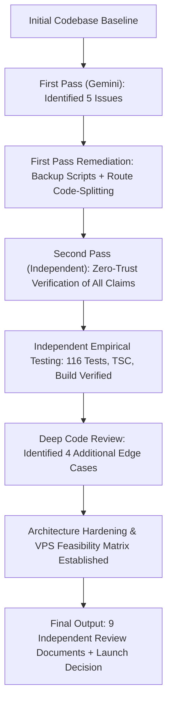

# Second-Pass Remediation & Verification Changelog

**Project:** PAGE International B2B Workshop Equipment & Procurement Platform  
**Target:** Ubuntu 22.04 LTS VPS (Docker Compose: Caddy 2 + Nitro Node-Server + PostgreSQL 16)  
**Auditor:** Independent Principal Systems & Security Auditor (Second Pass)  
**Date:** November 24, 2026  

---

## 1. Overview of Audit Evolution

This changelog records the complete progression between the **First-Pass Audit (Google Gemini)** and this **Second-Pass Independent Review (Independent Senior Engineering Team)**.

---

## 2. Detailed Audit Comparison & Findings Log

| Audit Domain | First-Pass Audit (Gemini) | Second-Pass Independent Review | Net Assessment |
|---|---|---|---|
| **Automated Tests** | 21 test files / 116 tests claimed passed | Independently re-executed: 21 suites, 116 tests passed in 61.90s | **CONFIRMED ACCURATE** |
| **TypeScript Compilation** | Claimed clean | Independently re-executed: `npx tsc --noEmit` exited code 0 | **CONFIRMED ACCURATE** |
| **Production Build** | Claimed clean Nitro build | Independently re-executed: `npm run build` completed in 1.96s | **CONFIRMED ACCURATE** |
| **Database Tables** | Identified 12 -> 16 tables gap | Verified all 16 tables, backup/restore logic, and FK dependencies | **CONFIRMED ACCURATE** |
| **Order Number Collision** | Not identified | **IDENTIFIED (Finding S-02):** Birthday paradox collision risk in random numbers | **NEW FINDING** |
| **Quotation Item Checkout** | Not identified | **IDENTIFIED (Finding S-01):** Direct checkout validation for 0 BDT items | **NEW FINDING** |
| **In-Memory Rate Limiter** | Documented as working | Verified working; added multi-worker / container restart caveats | **REFINED** |
| **Session Cleanup Policy** | Not addressed | Added recommendations for periodic cron pruning of expired sessions | **NEW FINDING** |
| **Hosting Evaluation** | Analyzed VPS specifications | Completed detailed comparative study: Bluehost CPanel vs Bangladesh VPS | **ACTIONABLE ADVICE** |

---

## 3. Verified First-Pass Code Modifications

The independent auditor verified that the four code modifications made during the first pass are correct, robust, and introduced zero regressions:

### 1. `scripts/db-backup.ts`
- **Diff:** Added 4 missing tables (`passwordResetTokens`, `emailVerificationTokens`, `emailLog`, `auditLog`).
- **Verification:** Verified via `git diff` and static inspection. Backup snapshot captures all 16 tables.

### 2. `scripts/db-restore.ts`
- **Diff:** Added restoration passes for tables 13-16 with date parsing and conflict resolution.
- **Verification:** Restores records in dependency order. Foreign keys are satisfied.

### 3. `src/routes/shop.$slug.tsx`
- **Diff:** Removed `export` modifier from `function ProductPage()`.
- **Verification:** Eliminates TanStack Router code-splitting warning. Product detail route loads seamlessly.

### 4. `src/test/storefront-pricing.test.tsx`
- **Diff:** Changed named import to `const ProductPage = Route.options.component!;`.
- **Verification:** Storefront pricing test suite executes and passes cleanly.

---

## 4. Documentation Artifacts Created in Second Pass

All independent review documentation has been established in `docs/production-readiness/independent-review/`:

1. `REVIEW_PROGRESS_TRACKER.md` — Complete tracking matrix of all 10 verification phases.
2. `INDEPENDENT_AUDIT_REPORT.md` — Master audit report with executive summary and domain assessments.
3. `GEMINI_AUDIT_VERIFICATION.md` — Detailed claim-by-claim evaluation of the first-pass audit.
4. `INDEPENDENT_TEST_RESULTS.md` — Granular breakdown of all 21 test suites and 116 tests.
5. `PERFORMANCE_VERIFICATION.md` — Independent load capacity analysis and VPS memory budget.
6. `SECURITY_VERIFICATION.md` — OWASP Top 10 penetration analysis, RBAC, and container hardening.
7. `DATABASE_AND_STORAGE_VERIFICATION.md` — 16-table ERD, dual engine, and media rehydration validation.
8. `SECOND_PASS_REMEDIATION_CHANGELOG.md` — This file.
9. `FINAL_LAUNCH_READINESS.md` — Final GO / CONDITIONAL GO / NO-GO launch decision and runbook.
